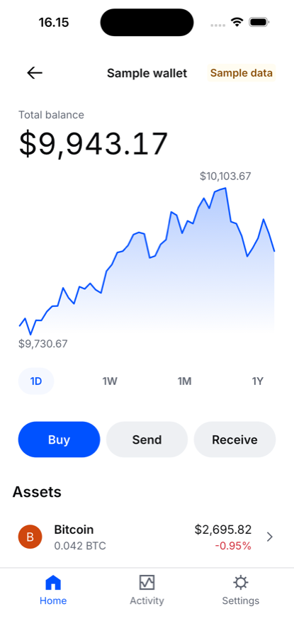
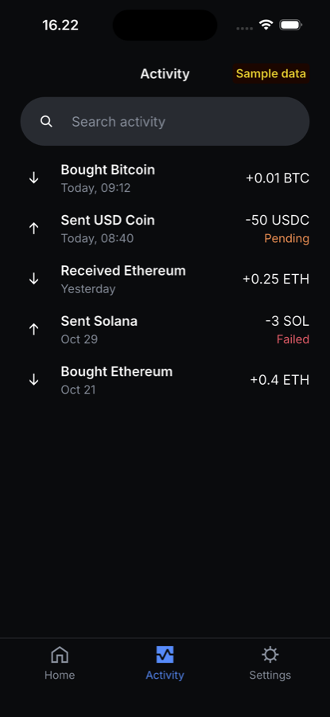
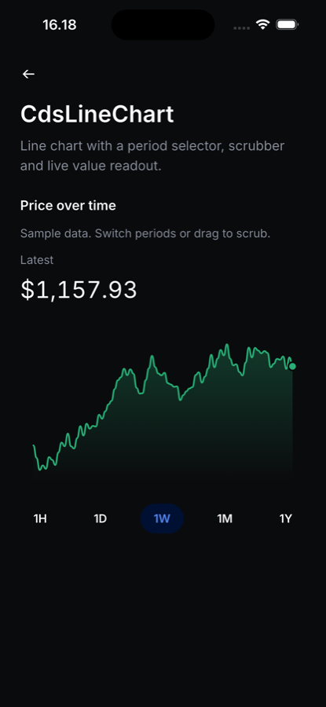

# cds_flutter

[](https://pub.dev/packages/cds_flutter)
[](https://github.com/mralifakbar/cds_flutter/actions/workflows/ci.yml)
[](LICENSE)
[](https://flutter.dev)

An unofficial Flutter port of the [Coinbase Design System](https://cds.coinbase.com) (CDS). It includes CDS tokens, light, dark and high-contrast themes, 552 icons and more than 150 components, all built for touch.

> **Not affiliated with Coinbase.** This is an independent, community-maintained port of the open-source CDS (Apache-2.0). "Coinbase" is a trademark of Coinbase, Inc. and is used here only to say what this package is a port of. Coinbase logos and proprietary fonts are not included.

<p>
  
  
  
</p>

## Why

CDS ships for React and React Native. This package brings the same tokens, components and behavior to Flutter, so a Flutter app can look and behave like a CDS product on iOS, Android, web and desktop.

- **Faithful to CDS.** Colors, spacing, radii, type ramp, motion curves and component dimensions are generated from or checked against the CDS source. Prop names follow CDS (`onPress`, `variant`, `startIcon`, `helperText`), so CDS docs translate directly.
- **Motion that answers touch.** Pressables respond the moment a finger lands. Springs start from wherever the element is, so you can grab and reverse a transition mid-flight. Sheets follow the finger, keep the release velocity and rubberband at their edges. Nothing loops forever, and reduced motion is respected everywhere.
- **Accessible by default.** Every control has semantics, a hit area of at least 44px, keyboard support, a focus ring and contrast-checked tokens. The high-contrast theme switches in automatically. Text can scale up to 2x and layouts follow RTL.
- **Built for AI coding agents.** There is one reference page per component and an index in `llms.txt`. The package ships two installable agent skills: one covers components and tokens, the other covers craft and accessibility.
- **Tested.** More than 1,200 tests cover widgets, gestures, semantics, keyboard input and both themes. Every gallery demo is smoke-tested in light, in dark and at 2x text scale.

## Install

```sh
flutter pub add cds_flutter
```

Requires Flutter 3.35 or newer. Inter, Source Code Pro and the CDS icon font are bundled, so there is nothing else to set up.

## Quick start

```dart
import 'package:cds_flutter/cds_flutter.dart';
import 'package:flutter/material.dart';

void main() => runApp(
      CdsThemeProvider(
        colorScheme: CdsColorSchemePreference.system,
        child: Builder(
          builder: (context) => MaterialApp(
            theme: cdsMaterialTheme(context.cds),
            home: const WalletScreen(),
          ),
        ),
      ),
    );

class WalletScreen extends StatelessWidget {
  const WalletScreen({super.key});

  @override
  Widget build(BuildContext context) {
    return CdsScaffold(
      header: const CdsNavigationBar(title: 'Wallet'),
      body: CdsVStack(padding: 3, gap: 2, children: [
        const CdsText.label2('Total balance', color: CdsColor.fgMuted),
        CdsRollingNumber(value: 1204.18, format: const CdsNumberFormat.currency(), font: CdsFont.display3),
        CdsListCell(
          spacingVariant: CdsCellSpacingVariant.condensed,
          media: const CdsAvatar(name: 'Bitcoin', colorScheme: CdsHue.orange),
          title: 'Bitcoin',
          description: '0.012 BTC',
          detail: r'$780.40',
          accessory: CdsCellAccessoryType.arrow,
          onPress: () {},
        ),
      ]),
      footer: CdsStickyFooter(
        child: CdsButton(label: 'Buy Bitcoin', block: true, onPress: () {}),
      ),
    );
  }
}
```

Read the theme anywhere with `context.cds`: `context.cds.color.fgMuted`, `context.cds.space(2)` (16px), `context.cds.typography[CdsFont.headline]`.

## Components

| Category | Components |
| --- | --- |
| Primitives | `CdsText`, `CdsIcon`, `CdsBox`, `CdsHStack`, `CdsVStack`, `CdsSpacer`, `CdsDivider`, `CdsPressable` |
| Buttons | `CdsButton`, `CdsIconButton`, `CdsButtonGroup`, `CdsSlideButton`, `CdsTileButton`, `CdsAvatarButton` |
| Text entry | `CdsTextInput`, `CdsTextFormField`, `CdsTextArea`, `CdsSearchInput`, `CdsOtpInput`, `CdsNumpad`, `CdsInputStack` |
| Selection | `CdsCheckbox`, `CdsCheckboxGroup`, `CdsCheckboxCell`, `CdsRadio`, `CdsRadioGroup`, `CdsRadioCell`, `CdsSwitch`, `CdsControlGroup`, `CdsSegmentedControl`, `CdsSlider`, `CdsRangeSlider`, `CdsChip`, `CdsInputChip`, `CdsMediaChip` |
| Select | `CdsSelect`, `CdsCombobox`, `CdsSelectChip` |
| Dates | `CdsCalendar`, `CdsDateInput`, `CdsDatePicker`, `CdsTimePicker` |
| Cells | `CdsListCell`, `CdsContentCell`, `CdsCell`, `CdsCellMedia`, `CdsListCellFallback` |
| Cards | `CdsContentCard` (+ header, body, footer), `CdsDataCard`, `CdsMessagingCard`, `CdsNudgeCard`, `CdsUpsellCard`, `CdsMediaCard`, `CdsContainedAssetCard`, `CdsFloatingAssetCard` |
| Media | `CdsAvatar`, `CdsRemoteImage`, `CdsRemoteImageGroup` |
| Display | `CdsTag`, `CdsLink`, `CdsDotCount`, `CdsDotStatusColor`, `CdsDotSymbol`, `CdsCodeSnippet`, `CdsKbd` |
| Tables | `CdsTable`, `CdsTableHeader`, `CdsTableBody`, `CdsTableFooter`, `CdsTableRow`, `CdsTableCell`, `CdsTableCaption`, `CdsTableCellFallback` |
| Feedback | `CdsBanner`, `CdsFallback`, `CdsProgressBar` (+ fixed and float labels), `CdsProgressCircle`, `CdsSpinner`, `CdsEmptyState` |
| Overlays | `showCdsModal`, `showCdsFullscreenModal`, `showCdsAlert`, `showCdsFullscreenAlert`, `showCdsTray`, `showCdsDrawer`, `showCdsToast`, `CdsTooltip`, `CdsPopoverPanel`, `CdsDropdown`, `CdsContextMenu`, `CdsCoachmark`, `CdsTour`, `CdsFocusTrap` |
| Layout | `CdsScaffold`, `CdsStickyFooter`, `CdsGrid`, `CdsAccordion`, `CdsCollapsible`, `CdsCarousel`, `CdsPageIndicator`, `CdsMultiContentModule`, `CdsTimeline` |
| Navigation | `CdsNavigationBar`, `CdsTopNavBar`, `CdsBottomNavigation`, `CdsTabs`, `CdsSegmentedTabs`, `CdsTabbedChips`, `CdsTabNavigation`, `CdsSidebar`, `CdsBreadcrumb`, `CdsPagination`, `CdsStepper`, `CdsSectionHeader`, `CdsPageHeader`, `CdsPageFooter`, `CdsRefreshControl` |
| Charts | `CdsSparkline`, `CdsSparklineGradient`, `CdsSparklineInteractive`, `CdsLineChart`, `CdsAreaChart`, `CdsBarChart`, `CdsPercentageBarChart`, `CdsCartesianChart`, `CdsXAxis`, `CdsYAxis`, `CdsScrubber`, `CdsReferenceLine`, `CdsPoint`, `CdsLegend`, `CdsPeriodSelector` |
| Numbers | `CdsRollingNumber` |

Some components are additions that CDS does not have, built from CDS tokens in CDS style: `CdsSlider`, `CdsRangeSlider`, `CdsOtpInput`, `CdsTextArea`, `CdsTextFormField`, `CdsTimePicker`, `CdsDrawer`, `CdsContextMenu`, `CdsBottomNavigation`, `CdsBreadcrumb`, `CdsScaffold`, `CdsRefreshControl`, `CdsEmptyState`, `CdsTimeline`, `CdsPageIndicator`, `CdsCodeSnippet` and `CdsKbd`.

Each component has a reference page in [`doc/components/`](doc/components) with every parameter, its default, examples, accessibility notes and the CDS prop mapping.

## Guides

- [Getting started](doc/guides/getting-started.md)
- [Theming](doc/guides/theming.md): brand colors, licensed brand fonts, density, forcing a scheme for a subtree, Material interop
- [Tokens](doc/guides/tokens.md)
- [Motion](doc/guides/motion.md): springs, gestures, reduced motion
- [Accessibility](doc/guides/accessibility.md)
- [For AI coding agents](doc/guides/for-ai-agents.md)

## For AI coding agents

```sh
dart run cds_flutter:install_skill            # .claude/skills/cds-flutter and cds-flutter-craft
dart run cds_flutter:install_skill --agents   # also points AGENTS.md at them
```

- **cds-flutter** tells an agent which component, token and icon to use, and comes with the full reference docs.
- **cds-flutter-craft** is the quality standard: honest content, layouts that reflow from phone to desktop, accessibility, fluid touch motion, clear copy and clean comments. It ends with a delivery checklist the agent runs before handing over UI.

[`llms.txt`](llms.txt) indexes every page and [`llms-full.txt`](llms-full.txt) puts them all in one file.

## Example app

[`example/`](example) contains the full component gallery: every demo is interactive, works in light and dark, and has a theme switcher. It also contains a **sample wallet** that combines the components into real flows:

- buy with a numpad inside a tray
- send with inline address validation
- receive with a copyable address
- an activity list with search
- settings
- loading, empty and error states you can toggle

All data in the sample is generated and labeled "Sample data".

```sh
cd example
flutter run
# Open a page directly, useful for screenshots:
flutter run --dart-define=CDS_GALLERY_START=wallet
flutter run --dart-define=CDS_GALLERY_START=demo:CdsTextInput
```

## Testing

```sh
flutter test --exclude-tags golden   # widget, gesture, semantics and keyboard tests
flutter test --tags golden           # golden images, recorded on macOS
cd example && flutter test           # every demo in light, dark and 2x text, plus sample app flows
```

## Differences from CDS

- **Widget names and parameters.** Widgets are prefixed `Cds`. Colors take `CdsColor` tokens; the raw-color escape hatches keep the CDS `dangerouslySet...` names.
- **Fonts.** The default theme uses Inter and Source Code Pro, the same as CDS's open-source default theme. Coinbase Sans, Display and Mono are proprietary; if you have a license, plug them in through `CdsTypography` (see [Theming](doc/guides/theming.md)).
- **Not included.** Logo and wordmark components, brand-logo glyphs in the icon font, Lottie animations and illustration packs (pictogram, spot and hero images) are not shipped. Components that show artwork take a `Widget` slot instead.
- **Tap targets.** Small controls keep their CDS visual size but get a 44px hit area.
- **Sheets and trays** use spring physics with velocity projection instead of fixed-duration curves.
- **Per-component deviations** are listed in each reference page.

## License

- Code: [Apache License 2.0](LICENSE). See [NOTICE](NOTICE) for what is derived from CDS and what changed.
- Inter and Source Code Pro: SIL Open Font License 1.1 ([`assets/licenses/`](assets/licenses)). Both licenses are added to Flutter's license page automatically.

## Contributing

Read [CONTRIBUTING.md](CONTRIBUTING.md). It is the contract every component follows: API naming, tokens, the motion contract, accessibility, tests and the doc template. Please also read the [Code of Conduct](CODE_OF_CONDUCT.md). Report security issues privately as described in [SECURITY.md](SECURITY.md).

Questions go to [Discussions](https://github.com/mralifakbar/cds_flutter/discussions), bugs and component requests to [Issues](https://github.com/mralifakbar/cds_flutter/issues).
